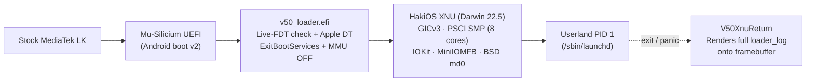

# HakiOS / XNU for Redmi Note 12 Pro 5G (`ruby`)

[-blue)](docs/HARDWARE.md)
[](docs/HARDWARE.md)
[](#boot-architecture)
[](#subsystem-status)

> **Language:** English | [Русский](README_RU.md)

Native **XNU (Darwin 22.5)** bring-up on **Xiaomi Redmi Note 12 Pro 5G (`ruby`, MediaTek MT6877 / Dimensity 1080)** using a **Mu-Silicium UEFI** chainloader and a source-built **HakiOS** kernel.

All milestones live on one linear `main` branch — from the early binary-patched bring-up (`v0.40 → v0.41b`) to the current source-built XNU kernel (`v0.50 → v0.52`) running **8-core PSCI SMP**, **GICv3 + architectural timer**, **framebuffer console**, **IOKit / BSD**, and **userland PID 1** on real phone hardware.

---

## On-Device Proof

Real photographs from Redmi Note 12 Pro 5G (`ruby`) hardware (zero storage/UFS writes):

| `v0.50` — Live XNU Boot Console + PID 1 | `v0.50` — Clean Return & Checksum | `v0.51b` — 8-Core SMP Active (`hw.ncpu=8`) |
| :---: | :---: | :---: |
|  |  |  |
| GICv3, IOKit, MiniIOMFB 60 Hz, BSD `md0`, `/sbin/launchd` | `GICv3:OK BSD:OK PID1:OK`, `ESR=0` | `hw.ncpu=8`, `hw.activecpu=8`, `640 MB` RAM |

---

## Subsystem Status

| Subsystem | Status | Notes |
| :--- | :---: | :--- |
| **Mu-Silicium UEFI & Boot v2 chain** | Confirmed on phone | RAM-packed FAT16 transport (`BOOTAA64.EFI` + `PAYLOAD.XNP`) |
| **Live-FDT parser & RAM selector** | Confirmed on phone | Validates LK live-FDT at `0x47C80000`, picks clean `<4 GiB` window (`640 MiB`) |
| **Source-built XNU (`Darwin 22.5`)** | Confirmed on phone | `GenericARMPE`, MMU, VM, `IOKit`, `IONVRAM`, `AMFI/SandBox` stand-ins |
| **GICv3 & Virtual Timer (`PPI 27`)** | Confirmed on phone | `GICD 0x0C000000`, `GICR 0x0C040000`, `CNTFRQ = 13 MHz` |
| **8-Core PSCI SMP** | Confirmed on phone | 6× Cortex-A55 + 2× Cortex-A78/A76 via PSCI SMC (`v0.51b`) |
| **Display (`video_console` + IOMFB)** | Confirmed on phone | LK framebuffer `0x7C406000` (`1080×2400`, 60 Hz) |
| **BSD `mockfs` + Userland PID 1** | Confirmed on phone | `/sbin/launchd` (`userland/hello`), clean exit back to loader log viewer |
| **Keypad (`KPD`) & Touch (`SPI3`)** | QEMU verified (`v0.52`) | `KPD @ 0x10010000` + `SPI3 @ 0x11013000` (`FT3680`/`GT9916R`), awaiting phone test |
| **Full RAM (`>4 GiB` DRAM / Rank 1)** | WIP (SError) | `0x140000000` triggers SError on `DAIF.A` unmask; isolated in `v0.51b` |
| **Storage (MT6877 UFS)** | Planned | `ufshci@11270000` not ported yet; **all current images are strictly RAM-only** |
| **Full iOS Userland / SpringBoard** | Planned | Requires UFS / rootfs, `dyld`, and expanded RAM |

---

## Boot Architecture



Key design choices:
- **Zero UFS/storage writes:** every diagnostic and bring-up image runs exclusively from RAM so stock Android partitions remain untouched (only temporary `boot` testing with stock `boot.img` restore).
- **On-screen post-mortem:** `v50_loader.efi` installs `V50XnuReturn` in XNU's `loader_stub_slot`. Whether PID 1 exits cleanly or the kernel panics, the loader regains the framebuffer and prints `ESR`, status flags, and the full tail of `loader_log`.
- **Single-source hardware validation:** GIC, timer, CPU topology, and RAM bounds are parsed dynamically from the live LK device tree rather than blindly assumed.

---

## Milestones (`main` Branch)

| Tag | Milestone | Target | Key Result |
| :--- | :--- | :--- | :--- |
| [`v0.40`](docs/history/PHONE_EVIDENCE.md) | Native XNU cooperative context switch | Phone + QEMU | Confirmed `Switch_context` round-trip on `ruby` hardware |
| `v0.41-wip` | Preemption prep (IRQ masked) | QEMU | Fixed `.extra` patch overlap bug, reproducible builds |
| `v0.41a` | One-shot virtual timer IRQ (`PPI 27`) | QEMU | EL1t handler, single `IAR/EOI`, `restore_error=0` |
| `v0.41b` | Timer-driven preemption via XNU AST | QEMU | `thread_wakeup_prim` → `ast_taken_kernel` → `Switch_context` |
| `v0.50` | **Source-built HakiOS XNU + PID 1** | **Phone + QEMU** | Live XNU console, GICv3, IOKit, BSD `md0`, `Hello from user space on Darwin!` |
| `v0.51` | 8-core SMP + `>4 GiB` RAM test | QEMU / Phone | Triggered SError on `>4 GiB` DRAM (`0x140000000`) |
| `v0.51b` | **8-core PSCI SMP (`<4 GiB` RAM)** | **Phone + QEMU** | Confirmed `hw.ncpu=8`, `hw.activecpu=8`, `640 MB` on `ruby` |
| `v0.52` | Keypad (`KPD`) + `SPI3` Touch + interactive PID 1 | QEMU (Phone next) | `/dev/hakios-touch` verified in QEMU; ready for on-device test |

---

## Repository Layout

```text
.
├── ebsprobe/                  # UEFI loader (v50_loader.c, v50_asm.S, v50_ram_select.h) & legacy v0.41 probes
├── v50-kernel-config/         # Reproducible ruby kernel config, device.conf, MTK drivers & userland/hello.c
│   ├── device.conf
│   ├── ruby_defconfig
│   ├── drivers/               # hakios.mtk_buttons.c, hakios.mtk_touch.c
│   └── userland/              # hello.c (PID 1 bring-up test)
├── build_v50.py               # Builds v50_loader.efi, packs PAYLOAD.XNP & Android boot.img
├── package_image.py           # Mu-Silicium FV / RAM-packed FAT16 / Android boot v2 packager
├── tools/blobs.sh             # Restores large base images (kept outside git, verified via BLOBS.sha256)
├── quality-tools/             # Packaging, chain, and patch-range verification scripts
├── docs/
│   ├── BUILD.md               # Full build, QEMU, and on-device testing guide (WSL2)
│   ├── HARDWARE.md            # Verified MT6877 / ruby memory map, GICv3, clocks, peripherals
│   ├── media/                 # On-device proof photographs
│   └── history/               # Archived v0.40 / v0.41 reports and handoff docs
└── archive/                   # Preserved historical v0.41 overlap-failure artifacts (not build inputs)
```

---

## Quick Start (WSL2 Debian)

Large base binaries (`inputs/*.img`) are stored outside git and verified via `BLOBS.sha256`. See **[docs/BUILD.md](docs/BUILD.md)** for full environment setup, kernel compilation, and QEMU testing.

```sh
cd ~/hackios/ruby
tools/blobs.sh restore
~/hackios/env/run.sh python -B build_v50.py
```

The resulting Android `boot` image is written to `out/v52/Mu-ruby-v0.52-hakios-input.img` together with `manifest.json` (SHA-256 checksums for kernel, ramdisk, EFI, payload, and final image).

> **Warning:** Always keep a verified backup of your stock `boot.img` before testing any bring-up image.

---

## Documentation

- [Build, QEMU & On-Device Guide](docs/BUILD.md)
- [Redmi Note 12 Pro 5G (`ruby` / MT6877) Hardware Map](docs/HARDWARE.md)
- [Русская версия README](README_RU.md)
- [Historical v0.40–v0.41 Reports & Handoff](docs/history/README.md)

## Roadmap

1. Verify `v0.52` buttons (`KPD`) and touchscreen (`SPI3` `FT3680`/`GT9916R`) on real `ruby` hardware.
2. Diagnose and fix the `>4 GiB` DRAM SError (`0x140000000`) to unlock the full 4+ GiB RAM window.
3. Bring up MT6877 UFS storage (`ufshci@11270000`) read-only first, then mount rootfs.
4. Transition from `userland/hello` to full `hackios-xnu-userland` (`dyld`, real `launchd`, SpringBoard).

## Credits & Upstream Projects

- [oosexgang/hakios-xnu-kernel](https://github.com/oosexgang/hakios-xnu-kernel) — HakiOS XNU kernel and platform layers
- [oosexgang/hackios-xnu-userland](https://github.com/oosexgang/hackios-xnu-userland) — HakiOS userland
- [oosexgang/hakios-mt6768](https://github.com/oosexgang/hakios-mt6768) — MediaTek reference port
- [oosexgang/hakios-uefi](https://github.com/oosexgang/hakios-uefi) & [UniXNU/UniXNU](https://github.com/UniXNU/UniXNU) — UEFI and XNU boot references
