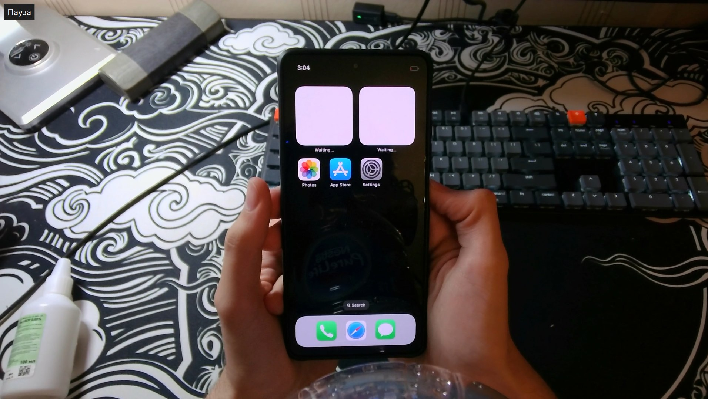
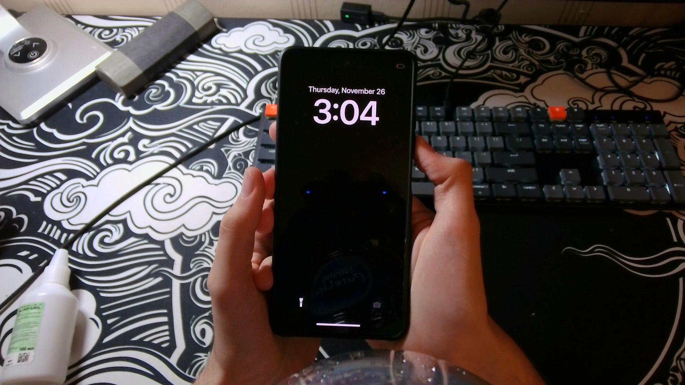
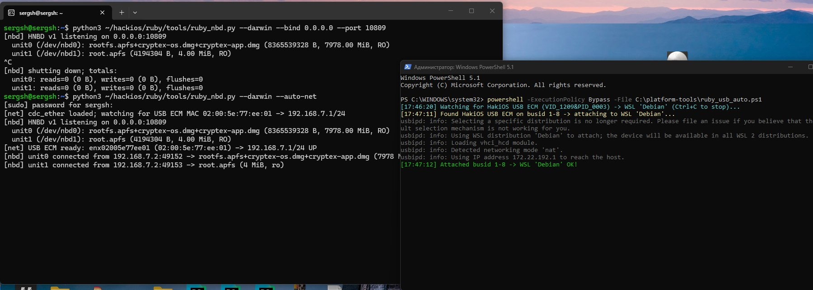
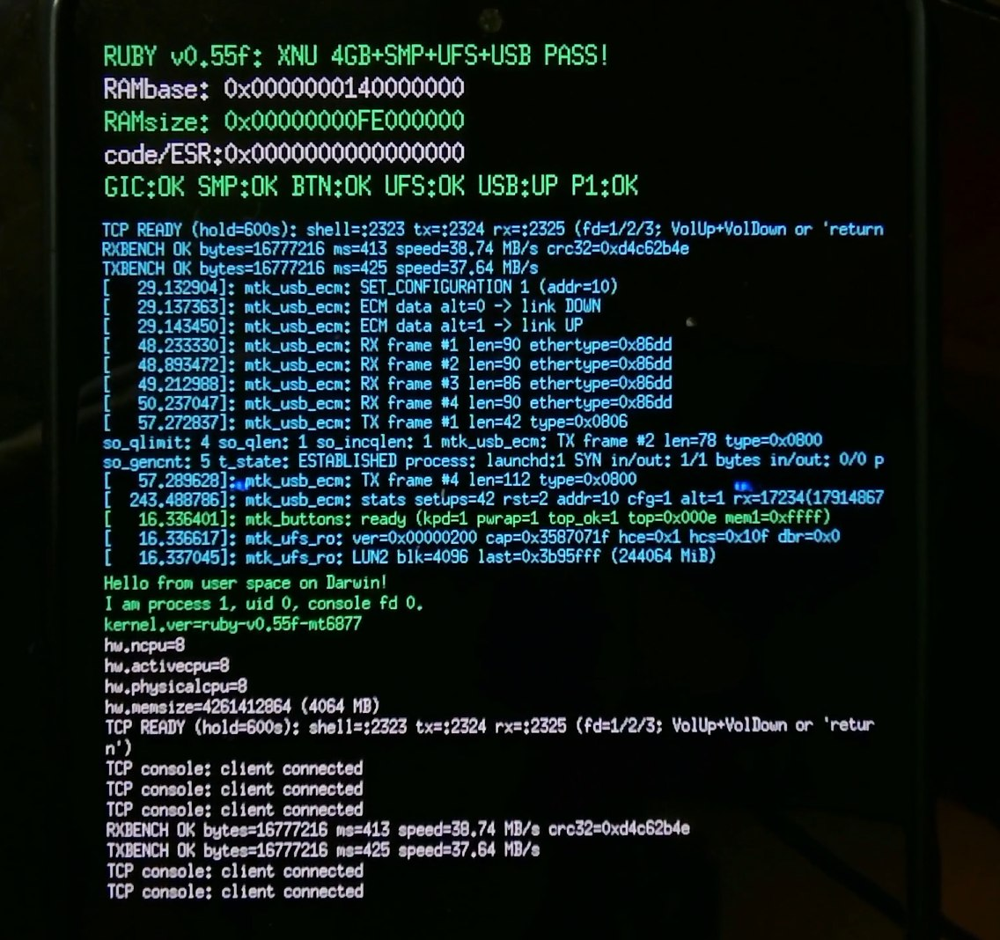

# HakiOS / XNU for Redmi Note 12 Pro 5G (`ruby`)

[-blue)](docs/HARDWARE.md)
[](docs/HARDWARE.md)
[](#boot-architecture)
[](#milestones-main-branch)
[](#on-device-proof)

> **Language:** English | [Русский](README_RU.md)

**SUCCESS — Full iOS 16.5 (`20F66`, Darwin 22.5) boots to a live Lock Screen & SpringBoard Home Screen with animations on a real Xiaomi Redmi Note 12 Pro 5G (`ruby`, MediaTek MT6877 / Dimensity 1080) over USB NBD with ZERO writes to phone UFS storage!**

All milestones live on one linear `main` branch — from the early binary-patched bring-up (`v0.40 → v0.41b`) to the current source-built **HakiOS / XNU 8796** kernel (`v0.50 → v0.60b`) booting full **iPhone X (`D22AP`) iOS 16.5 userland** directly over our **~38 MB/s MT6877 USB 2.0 CDC-ECM + HNBD v1** stack, with **4064 MiB DRAM above 4 GiB (`0x140000000`)**, **8-core PSCI SMP**, **GICv3 + virtual timer**, **MiniIOMobileFramebuffer 60 Hz**, **MT6359 + KPD physical buttons** (`Power` wake, `VolDown` hold → `Home` unlock, `VolUp+VolDown` → clean UEFI return), and **strictly read-only UFS**.

---

## On-Device Proof — iOS 16.5 SpringBoard on `ruby` (`v0.60b`)

Real photographs from **Redmi Note 12 Pro 5G (`ruby`)** running full iOS 16.5 (`20F66`) over USB NBD (zero UFS writes, Android intact):

| `v0.60b` — Live iOS 16.5 Home Screen (`SpringBoard`) | `v0.60b` — Live iOS 16.5 Lock Screen (`CoverSheet`) | `v0.60b` — 1-Second Auto-Attach USB ECM + Composite NBD |
| :---: | :---: | :---: |
|  |  |  |
| Photos, App Store, Settings, Search, Phone, Safari, Messages — unlocked via physical `VolDown`→`Home` | Real `backboardd` + `SpringBoard` on `ruby`, woken via physical `Power` button | `ruby_usb_auto.ps1` + `ruby_nbd.py --darwin --auto-net` (`unit0` 7.79 GiB composite + `unit1` 4 MiB) |

<details>
<summary>Earlier on-device milestones (<code>v0.55f</code>, <code>v0.54e</code>, <code>v0.51b</code>, <code>v0.50</code>)</summary>

| `v0.55f` — USB ECM `PASS!` (`38.7 / 37.6 MB/s`) | `v0.55f` — 16 MiB Bit-Exact DMA Bench + Shell | `v0.54e` — 4064 MiB `>4 GiB` RAM + 8-Core SMP |
| :---: | :---: | :---: |
|  |  |  |
| `GIC:OK SMP:OK BTN:OK UFS:OK USB:UP P1:OK`, `ESR=0` | `38.74 MB/s` RX, `37.64 MB/s` TX, `err=0`, `drop=0` | `RAMbase 0x140000000`, `4064 MB`, `8/8` CPUs |

| `v0.50` — First XNU Console + PID 1 | `v0.50` — Clean Return & Checksum | `v0.51b` — First 8-Core SMP (`hw.ncpu=8`) |
| :---: | :---: | :---: |
|  |  |  |
| GICv3, IOKit, MiniIOMFB 60 Hz, BSD `md0`, `/sbin/launchd` | `GICv3:OK BSD:OK PID1:OK`, `ESR=0` | `hw.ncpu=8`, `hw.activecpu=8`, `640 MB` RAM |

</details>

---

## Subsystem Status

| Subsystem | Status | Notes |
| :--- | :---: | :--- |
| **Mu-Silicium UEFI & Boot v2 chain** | Confirmed on phone | RAM-packed FAT16 transport (`BOOTAA64.EFI` + `PAYLOAD.XNP`), `--apple-splash` & `--darwin` modes |
| **Live-FDT parser & `>4 GiB` RAM selector** | Confirmed on phone | Validates LK FDT (`0x47C80000`), maps **`4064 MiB`** at `0x140000000..0x23E000000` (with `<4 GiB` `640 MiB` fallback) |
| **Source-built XNU (`Darwin 22.5`)** | Confirmed on phone | Includes `v0.54d` fixes (`io_map()` 16 KiB VA overlap + Cortex-A78 `FEAT_CCIDX`) & `D22AP` Apple DeviceTree |
| **GICv3 & Virtual Timer (`PPI 27`)** | Confirmed on phone | `GICD 0x0C000000`, `GICR 0x0C040000`, `CNTFRQ = 13 MHz`, USB `IRQ 160` (`SPI 128`) |
| **8-Core PSCI SMP** | Confirmed on phone | 6× Cortex-A55 + 2× Cortex-A78 via PSCI SMC (`hw.ncpu=8`, `hw.activecpu=8`) |
| **Display (`video_console` + IOMFB)** | Confirmed on phone | LK framebuffer `0x7C406000` (`1080×2400`, 60 Hz); `MiniIOMobileFramebuffer` `1125×2436` BGRA software CA render |
| **Physical Buttons (`KPD` + `MT6359`)** | Confirmed on phone | `Power` (wake/sleep), `VolUp`, `VolDown` (hold ~0.7 s → `HOME` unlock), `VolUp+VolDown` (1.5 s) → clean UEFI return |
| **UFS Storage (`ufshci@11270000`)** | Confirmed on phone (RO) | Strictly read-only `LUN 0..2` probe (`77` GPT partitions), **zero SCSI writes** — Android stays untouched |
| **USB MTU3 + 36-bit QMU + CDC-ECM (`en0`)** | Confirmed on phone | `VID 0x1209 / PID 0x0003`, `192.168.7.2/24`, **38.74 MB/s RX / 37.64 MB/s TX**, bit-exact CRC32, `0` drops |
| **HNBD v1 Network Block Device (`/dev/nbd0..3`)** | Confirmed on phone | Link-aware TCP block device (`192.168.7.1:10809`) serving composite `rootfs + OS/App Cryptex` (`7.79 GiB`) + `root.apfs` |
| **Full iOS 16.5 Userland (`SpringBoard`)** | **Confirmed on phone (`v0.60b`)** | Real `/sbin/launchd`, `dyld_shared_cache_arm64`, `backboardd`, Lock Screen & Home Screen with UI animations |
| **Touchscreen (`SPI3` FocalTech `FT3680`)** | Next (`v0.60c`) | Disabled in `v0.60b` boot-args (`touchscreen=2` not enabled yet); hardware driver bring-up next |
| **Persistent `/private/var` (`var.hfs` on `nbd2`) & SSH** | Next (`v0.60c`) | Currently `tmpfs`; adding RW `var.hfs` over `nbd2` + `sshd` over USB (`192.168.7.2:22`) |

---

## Boot Architecture (`v0.60b` iOS 16.5 over NBD)

```text
MediaTek LK (boot_a, Android boot.img v2 — only boot_a is flashed)
  └─► Mu-Silicium UEFI (RAM-packed FAT16)
        └─► BOOTAA64.EFI (ebsprobe/v50_loader.c + D22AP identity.h)
              ├─ Validates live LK FDT at 0x47C80000 & maps 4064 MiB DRAM at 0x140000000
              ├─ Loads PAYLOAD.XNP (HakiOS XNU 8796 + 512 KiB flashboot.apfs md0)
              ├─ Installs V50XnuReturn post-mortem handler + optional Apple splash logo
              └─► XNU kernel_bootstrap() → 8-core SMP → IOKit → MiniIOMobileFramebuffer
                    ├─ mtk_buttons (KPD + PMIC MT6359: Power, VolUp, VolDown→HOME, VolUp+VolDown→UEFI)
                    ├─ mtk_ufs_ro  (UFSHCI LUN 0..2 GPT scan, strictly read-only)
                    ├─ mtk_usb_ecm (MTU3 + 36-bit QMU DMA → en0 192.168.7.2/24)
                    ├─ nbd0..3     (link-aware HNBD v1 client → host 192.168.7.1:10809)
                    └─► PID 1 (stage0 on md0)
                          ├─ Waits cleanly for USB ECM link + mounts /dev/nbd1 (root.apfs) → /redwood
                          ├─ exec /redwood/sbin/init → mounts RO /dev/nbd0 (rootfs.apfs) → /flash
                          ├─ sysctl kern.hakios_switch_root → / + /private/preboot
                          ├─ Mounts /dev/nbd0,c=1 (OS Cryptex / dyld_shared_cache) & ,c=2 (App Cryptex)
                          └─► exec /sbin/launchd.darwin → backboardd → SpringBoard (Lock Screen & Home Screen)
```

Key design choices:
- **Zero UFS writes:** only `boot_a` is flashed (and stock `boot.img` restores Android in seconds). All iOS images (`rootfs.apfs`, OS/App cryptexes, `root.apfs`) stay on the PC and stream over USB ECM via composite NBD without even concatenating an 8 GiB file on disk.
- **Hands-free PC auto-attach:** `tools/ruby_usb_auto.ps1` catches `VID_1209&PID_0003` in ~1 s and attaches it to WSL2 Debian, while `tools/ruby_nbd.py --darwin --auto-net` brings up `192.168.7.1/24` and serves all units automatically.
- **On-screen post-mortem:** `v50_loader.efi` installs `V50XnuReturn` in XNU's `loader_stub_slot`. Holding `VolUp+VolDown` (or any panic) cleanly returns to the UEFI summary screen with `ESR` and kernel log lines.

---

## Milestones (`main` Branch)

| Tag | Milestone | Verified On | Key Result |
| :--- | :--- | :--- | :--- |
| [`v0.40`](docs/history/PHONE_EVIDENCE.md) | Native XNU cooperative context switch | Phone + QEMU | Confirmed `Switch_context` round-trip on `ruby` hardware |
| `v0.41-wip`..`v0.41b` | Timer-driven preemption via XNU AST | QEMU | Fixed `.extra` overlap, `PPI 27` EL1t IRQ → `Switch_context` |
| `v0.50` | Source-built HakiOS XNU + PID 1 | **Phone** + QEMU | Live XNU console, GICv3, IOKit, BSD `md0`, `Hello from user space on Darwin!` |
| `v0.51b` | 8-core PSCI SMP (`<4 GiB` RAM) | **Phone** + QEMU | Confirmed `hw.ncpu=8`, `hw.activecpu=8`, `640 MiB` on `ruby` |
| `v0.52`..`v0.53d` | Buttons (`KPD`+`MT6359`), RO-UFS & `>4 GiB` SError diag | **Phone** + QEMU | Confirmed all 3 physical keys, RO-UFS `LUN 2` (`77` GPT partitions), isolated SError |
| `v0.54`..`v0.54d` | Fix `>4 GiB` SError (`io_map()` 16 KiB VA overlap + `FEAT_CCIDX`) | **Phone** + QEMU | Root-caused `SLVERR` on GICD (`0x0C000000`); booted `2 GiB` above 4 GiB cleanly |
| `v0.54e` | Unlock full `4064 MiB` `>4 GiB` RAM window | **Phone** + QEMU | Confirmed `hw.memsize=4261412864` (`0x140000000`), `8/8` SMP, `ESR=0` |
| `v0.55a`..`v0.55d` | MT6877 USB MTU3 + TPHY v2 + EP0 enumeration | **Phone** + QEMU | Fixed MTU3/TPHY offsets, 32-bit `FIFO0`, deferred `DATAEND`, clean Windows enumeration (`HakiOS USB ECM`) |
| `v0.55e` | USB 36-bit QMU DMA + CDC-ECM `en0` (`ping`) | **Phone** + QEMU | `USB:UP`, 5/5 ICMP replies (`0.502 ms` min, `0%` loss) over `usbipd-win` → WSL2 `cdc_ether` |
| `v0.55f` | Live TCP debug console + CRC32 USB DMA bench | **Phone** + QEMU | **38.74 MB/s RX / 37.64 MB/s TX** (16 MiB bit-exact CRC32, `0` drops), live shell `:2323` |
| `v0.56`..`v0.56b` | HNBD v1 (`/dev/nbd0..1`) + APFS/Mach-O exec over TCP | **Phone** + QEMU | Fixed 16-byte arm64 user SP alignment (`ESR_EC_SP_ALIGN`), mounted APFS & ran `execve` over USB NBD |
| `v0.60a` | First full iOS 16.5 (`20F66`) NBD boot to `SpringBoard` | QEMU + Phone | Composite `rootfs+cryptex-os+cryptex-app` NBD, `D22AP` `identity.h`, verified `SpringBoard` in QEMU |
| **`v0.60b`** | **Live iOS 16.5 Lock Screen & `SpringBoard` on `ruby`** | **Phone** + QEMU | **Link-aware NBD (zero link-down spam), 1-sec `usbipd` auto-attach, `VolDown`→`HOME` unlock, live iOS 16.5 UI & animations on real hardware!** |

---

## Repository Layout

```text
.
├── ebsprobe/                  # UEFI loader (v50_loader.c, v50_asm.S, v50_ram_select.h, v50_apple_logo.h) & legacy probes
├── v50-kernel-config/         # Reproducible ruby kernel config, patches, MT6877 drivers & PID 1 source
│   ├── device.conf
│   ├── ruby_defconfig
│   ├── xnu-v0.54d-fixes.patch          # XNU io_map() 16 KiB overlap + Cortex-A78 FEAT_CCIDX cache flush patch
│   ├── kernel-v0.60b-net-is-up.patch   # hakios_net_is_up() link-state hook for link-aware NBD
│   ├── userland-v0.60b-nbd.patch       # stage0 / init / build.sh flashboot + /dev/nbd1 support
│   ├── drivers/               # hakios.mtk_buttons.c, hakios.mtk_touch.c, hakios.mtk_ufs_ro.c, hakios.mtk_usb_ecm.c, hakios.nbd.c
│   └── userland/              # hello.c (standalone PID 1 TCP console :2323 + CRC32 DMA bench :2324/:2325)
├── tools/
│   ├── blobs.sh               # Restores large base images outside git (verified via BLOBS.sha256)
│   ├── ruby_nbd.py            # Composite HNBD v1 server (--darwin, --auto-net, optional RW --var-hfs)
│   ├── ruby_usb_auto.ps1      # Windows usbipd-win watcher for automatic 1209:0003 → WSL2 attach
│   └── ruby_net.py            # Host client for standalone TCP console & RX/TX CRC32 benchmarks
├── build_v50.py               # Builds v50_loader.efi, packs PAYLOAD.XNP & Android boot.img (--darwin, --apple-splash)
├── package_image.py           # Mu-Silicium FV / RAM-packed FAT16 / Android boot v2 packager
├── quality-tools/             # Packaging, chain, and patch-range verification scripts
├── docs/
│   ├── BUILD.md               # Full build, QEMU, USB ECM (usbipd-win + WSL2), and on-device guide
│   ├── HARDWARE.md            # Verified MT6877 / ruby memory map, GICv3, buttons, UFS, USB MTU3/TPHY
│   ├── media/                 # On-device proof photographs & benchmark captures
│   └── history/               # Archived v0.40 / v0.41 reports and handoff docs
└── archive/                   # Preserved historical v0.41 overlap-failure artifacts (not build inputs)
```

---

## Quick Start — Booting iOS 16.5 on `ruby` (WSL2 Debian + Windows)

Large base binaries (`inputs/*.img`) are stored outside git and verified via `BLOBS.sha256`. Proprietary Apple IPSW artifacts (`rootfs.apfs`, `cryptex-os.dmg`, `cryptex-app.dmg`, `identity.h`) are extracted locally from `iPhone10,3,iPhone10,6_16.5_20F66_Restore.ipsw` and never committed. See **[docs/BUILD.md](docs/BUILD.md)** for full environment setup.

```sh
cd ~/hackios/ruby
tools/blobs.sh restore
# Build iOS 16.5 Darwin boot image (verbose or clean Apple splash):
~/hackios/env/run.sh python -B build_v50.py --darwin
~/hackios/env/run.sh python -B build_v50.py --darwin --apple-splash
```

Start the host helpers **before** rebooting the phone:

1. **WSL2 Debian** (serves composite `nbd0` + `root.apfs` on `nbd1` and configures `192.168.7.1/24` automatically):
   ```sh
   python3 ~/hackios/ruby/tools/ruby_nbd.py --darwin --auto-net
   ```
2. **Windows PowerShell** (auto-attaches `VID_1209&PID_0003` to WSL2 Debian):
   ```powershell
   powershell -ExecutionPolicy Bypass -File tools\ruby_usb_auto.ps1
   ```
3. **Flash only `boot_a` in fastboot and reboot** (keep USB plugged in):
   ```powershell
   fastboot flash boot_a Mu-ruby-v0.60b-darwin-splash.img
   fastboot reboot
   ```

Controls on phone: **Power** wakes the Lock Screen, holding **Volume Down (~0.7 s)** sends `HOME` to unlock into SpringBoard, and holding **VolUp + VolDown (1.5 s)** returns cleanly to UEFI.

> **Warning:** Always keep a verified backup of your stock `boot.img` before testing any bring-up image (`fastboot flash boot_a boot.img` restores Android immediately).

---

## Documentation

- [Build, QEMU, USB ECM & On-Device Guide](docs/BUILD.md)
- [Redmi Note 12 Pro 5G (`ruby` / MT6877) Hardware Map](docs/HARDWARE.md)
- [Русская версия README](README_RU.md)
- [Historical v0.40–v0.41 Reports & Handoff](docs/history/README.md)

## Roadmap

1. **`v0.60c` — Touchscreen + Persistent `/private/var` + SSH:** bring up the `SPI3` touchscreen (`FocalTech FT3680` / `Goodix GT9916R`), mount RW `var.hfs` over `/dev/nbd2` for persistent settings and fast warm boots, and enable `sshd` over USB (`192.168.7.2:22`).
2. **UI smoothness & hardware polish:** tune `MiniIOMobileFramebuffer` scaling / multi-threaded blit (`fbscale`, `fb_threads`), display backlight (`DSI DCS 0x51`), and MT6360 battery reporting.

## Credits & Upstream Projects

- [lky005/ruby-ios-bringup](https://github.com/lky005/ruby-ios-bringup) — MT6877 / `ruby` hardware bring-up reference (buttons, UFS, USB MTU3/TPHY/QMU, Goodix GT9916R, backlight)
- [oosexgang/hakios-xnu-kernel](https://github.com/oosexgang/hakios-xnu-kernel) — HakiOS XNU kernel, userland, and platform layers
- [oosexgang/xnu-kernel-mtk-helio](https://github.com/oosexgang/xnu-kernel-mtk-helio) — MediaTek XNU kernel & IOMFB improvements
- [oosexgang/hackios-xnu-userland](https://github.com/oosexgang/hackios-xnu-userland) — HakiOS userland (archived, merged into `hakios-xnu-kernel`)
- [oosexgang/hakios-mt6768](https://github.com/oosexgang/hakios-mt6768) — MediaTek reference port
- [oosexgang/hakios-uefi](https://github.com/oosexgang/hakios-uefi) & [UniXNU/UniXNU](https://github.com/UniXNU/UniXNU) — UEFI and XNU boot references
