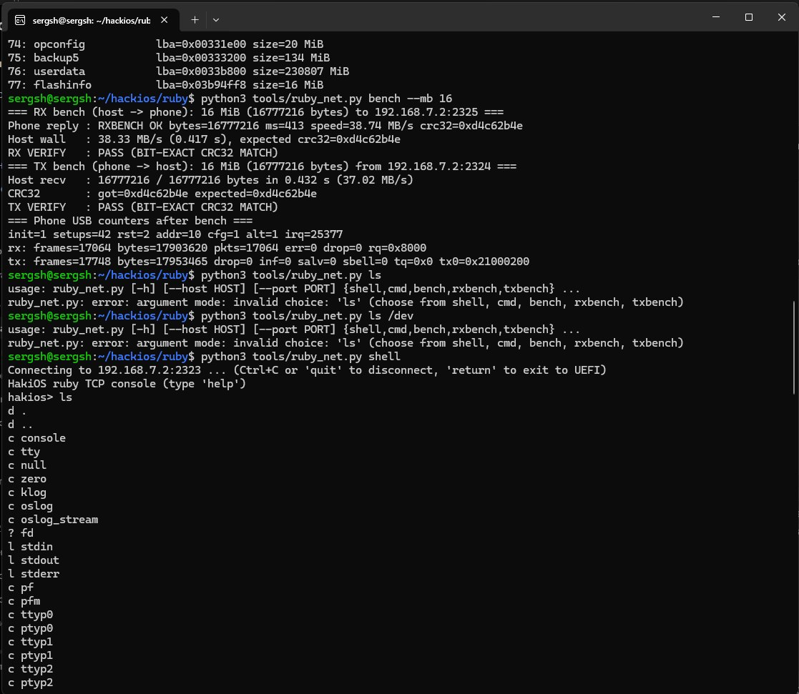
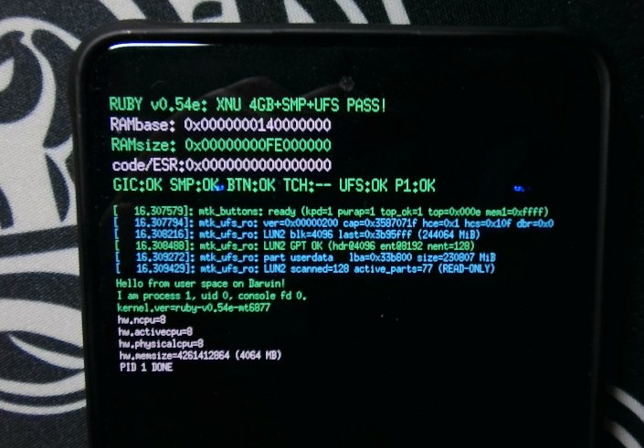
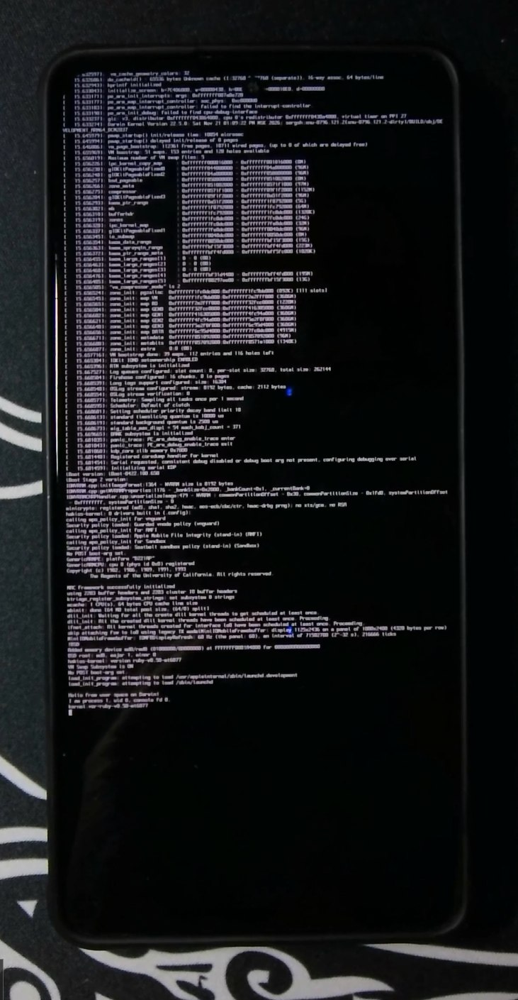
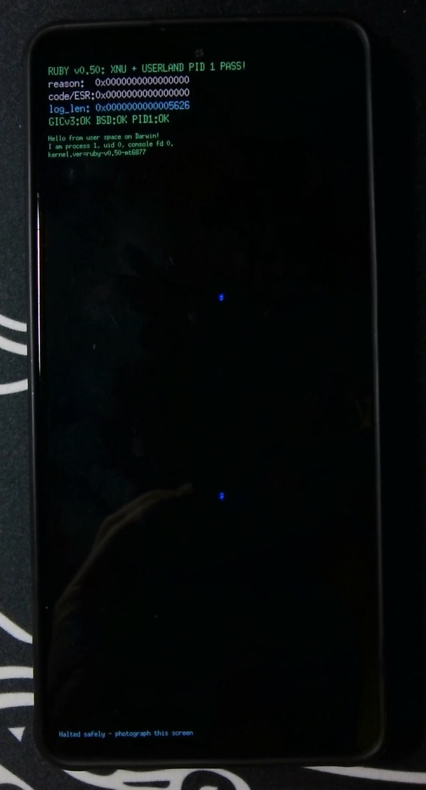
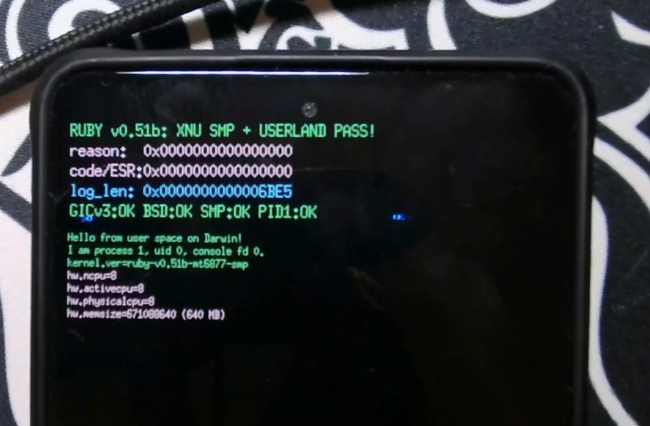

# HakiOS / XNU for Redmi Note 12 Pro 5G (`ruby`)

[-blue)](docs/HARDWARE.md)
[](docs/HARDWARE.md)
[](#boot-architecture)
[](#milestones-main-branch)
[](#subsystem-status)

> **Language:** English | [Русский](README_RU.md)

Native **XNU 8796 (Darwin 22.5)** bring-up on **Xiaomi Redmi Note 12 Pro 5G (`ruby`, MediaTek MT6877 / Dimensity 1080)** using a **Mu-Silicium UEFI** chainloader and a source-built **HakiOS** kernel.

All milestones live on one linear `main` branch — from the early binary-patched bring-up (`v0.40 → v0.41b`) to the current source-built XNU kernel (`v0.50 → v0.55f`) running on real phone hardware with **4064 MiB DRAM above 4 GiB (`0x140000000`)**, **8-core PSCI SMP**, **GICv3 + virtual timer**, **LK framebuffer console**, **MT6359 + KPD physical buttons**, **strictly read-only UFS GPT probing (77 partitions)**, and **MT6877 USB 2.0 High-Speed CDC-ECM networking (~38 MB/s bidirectionally, bit-exact CRC32)** with a live TCP debug console.

---

## On-Device Proof

Real photographs and host captures from Redmi Note 12 Pro 5G (`ruby`) hardware (zero UFS writes):

| `v0.55f` — USB ECM `PASS!` (`38.7 / 37.6 MB/s`) | `v0.55f` — 16 MiB Bit-Exact DMA Bench + Shell | `v0.54e` — 4064 MiB `>4 GiB` RAM + 8-Core SMP |
| :---: | :---: | :---: |
|  |  |  |
| `GIC:OK SMP:OK BTN:OK UFS:OK USB:UP P1:OK`, `ESR=0` | `38.74 MB/s` RX, `37.64 MB/s` TX, `err=0`, `drop=0` | `RAMbase 0x140000000`, `4064 MB`, `8/8` CPUs |

<details>
<summary>Earlier on-device milestones (<code>v0.50</code> &amp; <code>v0.51b</code>)</summary>

| `v0.50` — First XNU Console + PID 1 | `v0.50` — Clean Return & Checksum | `v0.51b` — First 8-Core SMP (`hw.ncpu=8`) |
| :---: | :---: | :---: |
|  |  |  |
| GICv3, IOKit, MiniIOMFB 60 Hz, BSD `md0`, `/sbin/launchd` | `GICv3:OK BSD:OK PID1:OK`, `ESR=0` | `hw.ncpu=8`, `hw.activecpu=8`, `640 MB` RAM |

</details>

---

## Subsystem Status

| Subsystem | Status | Notes |
| :--- | :---: | :--- |
| **Mu-Silicium UEFI & Boot v2 chain** | Confirmed on phone | RAM-packed FAT16 transport (`BOOTAA64.EFI` + `PAYLOAD.XNP`) |
| **Live-FDT parser & `>4 GiB` RAM selector** | Confirmed on phone | Validates LK FDT (`0x47C80000`), maps **`4064 MiB`** at `0x140000000..0x23E000000` (with `<4 GiB` `640 MiB` fallback) |
| **Source-built XNU (`Darwin 22.5`)** | Confirmed on phone | Includes `v0.54d` fixes: `io_map()` 16 KiB VA overlap + Cortex-A78 `FEAT_CCIDX` cache flush |
| **GICv3 & Virtual Timer (`PPI 27`)** | Confirmed on phone | `GICD 0x0C000000`, `GICR 0x0C040000`, `CNTFRQ = 13 MHz`, USB `IRQ 160` (`SPI 128`) |
| **8-Core PSCI SMP** | Confirmed on phone | 6× Cortex-A55 + 2× Cortex-A78 via PSCI SMC (`hw.ncpu=8`, `hw.activecpu=8`) |
| **Display (`video_console` + IOMFB)** | Confirmed on phone | LK framebuffer `0x7C406000` (`1080×2400`, 60 Hz); optional `--apple-splash` boot logo |
| **Physical Buttons (`KPD` + `MT6359`)** | Confirmed on phone | `VolDown` (`KPD`), `Power`/`VolUp` (`PMIC MT6359` via read-only `pwrap`), `VolUp+VolDown` clean return |
| **UFS Storage (`ufshci@11270000`)** | Confirmed on phone (RO) | Strictly read-only `LUN 0..2` probe; parses `77` GPT partitions (`userdata` `230 807 MiB`), **zero SCSI writes** |
| **USB MTU3 + 36-bit QMU + CDC-ECM (`en0`)** | Confirmed on phone | `VID 0x1209 / PID 0x0003`, `192.168.7.2/24`, **38.74 MB/s RX / 37.64 MB/s TX**, bit-exact CRC32, `0` drops |
| **TCP Debug Console & DMA Bench (`PID 1`)** | Confirmed on phone | `:2323` shell (`info/mem/usb/ufs/dmesg/ls/sysctl/touch/return`), `:2324` TX / `:2325` RX CRC32 bench |
| **Touchscreen (`SPI3` FocalTech `FT3680`)** | Deferred | Deferred until after iOS userland (virtual touch injection via `/dev/hakios-touch` works over USB) |
| **Full iOS 16.5 Userland (`SpringBoard`)** | Next (`v0.56 → v0.60`) | Network-backed APFS rootfs over USB ECM → real `launchd`, SSH, `backboardd`, `SpringBoard` |

---

## Boot Architecture

```text
MediaTek LK (boot.img v2)
  └─► Mu-Silicium UEFI (RAM-packed FAT16)
        └─► BOOTAA64.EFI (ebsprobe/v50_loader.c)
              ├─ Validates live LK FDT at 0x47C80000
              ├─ Selects 4064 MiB DRAM window at 0x140000000 (fallback: 640 MiB @ 0x90000000)
              ├─ Loads PAYLOAD.XNP (source-built HakiOS XNU 8796 + PID 1 Mach-O)
              ├─ Installs V50XnuReturn post-mortem handler + optional Apple splash
              └─► XNU kernel_bootstrap() → 8-core SMP → IOKit → BSD md0
                    ├─ mtk_buttons (KPD + PMIC MT6359, read-only)
                    ├─ mtk_ufs_ro  (UFSHCI LUN 0..2 GPT scan, strictly read-only)
                    ├─ mtk_usb_ecm (MTU3 + 36-bit QMU DMA → en0 192.168.7.2/24)
                    └─► PID 1 (/sbin/launchd → TCP console :2323 + DMA bench :2324/:2325)
                          └─► Clean return ('return' or VolUp+VolDown) → UEFI summary screen
```

Key design choices:
- **Zero UFS writes:** every image in this repository runs from RAM and probes UFS strictly read-only (no SCSI `WRITE` command exists in the driver), keeping Android and `userdata` untouched.
- **Fast USB 2.0 network transport (~38 MB/s):** provides live debugging (`dmesg`, `sysctl`, `ufs`, `usb`) today and will back network-mounted APFS rootfs images in `v0.56` without modifying phone storage.
- **On-screen post-mortem:** `v50_loader.efi` installs `V50XnuReturn` in XNU's `loader_stub_slot`. Whether PID 1 exits cleanly (via TCP `return` or holding `VolUp+VolDown`) or XNU panics, the loader regains the framebuffer and prints `ESR`, subsystem badges (`GIC/SMP/BTN/UFS/USB/P1`), and key log lines.

---

## Milestones (`main` Branch)

| Tag | Milestone | Verified On | Key Result |
| :--- | :--- | :--- | :--- |
| [`v0.40`](docs/history/PHONE_EVIDENCE.md) | Native XNU cooperative context switch | Phone + QEMU | Confirmed `Switch_context` round-trip on `ruby` hardware |
| `v0.41-wip`..`v0.41b` | Timer-driven preemption via XNU AST | QEMU | Fixed `.extra` overlap, `PPI 27` EL1t IRQ → `Switch_context` |
| `v0.50` | Source-built HakiOS XNU + PID 1 | **Phone** + QEMU | Live XNU console, GICv3, IOKit, BSD `md0`, `Hello from user space on Darwin!` |
| `v0.51b` | 8-core PSCI SMP (`<4 GiB` RAM) | **Phone** + QEMU | Confirmed `hw.ncpu=8`, `hw.activecpu=8`, `640 MiB` on `ruby` |
| `v0.52`..`v0.53d` | Buttons (`KPD`+`MT6359`), RO-UFS & `>4 GiB` SError diag | **Phone** + QEMU | Confirmed all 3 physical keys, RO-UFS `LUN 2` (`77` GPT partitions), isolated SError |
| `v0.54`..`v0.54d` | Fix `>4 GiB` SError (`io_map()` 16 KiB VA overlap + `FEAT_CCIDX`) | **Phone** + QEMU | Root-caused `SLVERR` on GICD (`0x0C000000`); booted `2 GiB` above 4 GiB cleanly |
| `v0.54e` | Unlock full `4064 MiB` `>4 GiB` RAM window | **Phone** + QEMU | Confirmed `hw.memsize=4261412864` (`0x140000000`), `8/8` SMP, `ESR=0` |
| `v0.55a`..`v0.55d` | MT6877 USB MTU3 + TPHY v2 + EP0 enumeration | **Phone** + QEMU | Fixed MTU3/TPHY offsets, 32-bit `FIFO0`, deferred `DATAEND`, clean Windows enumeration (`HakiOS USB ECM`) |
| `v0.55e` | USB 36-bit QMU DMA + CDC-ECM `en0` (`ping`) | **Phone** + QEMU | `USB:UP`, 5/5 ICMP replies (`0.502 ms` min, `0%` loss) over `usbipd-win` → WSL2 `cdc_ether` |
| **`v0.55f`** | **Live TCP debug console + CRC32 USB DMA bench** | **Phone** + QEMU | **38.74 MB/s RX / 37.64 MB/s TX** (16 MiB bit-exact CRC32, `0` drops), live shell `:2323` |

---

## Repository Layout

```text
.
├── ebsprobe/                  # UEFI loader (v50_loader.c, v50_asm.S, v50_ram_select.h, v50_apple_logo.h) & legacy probes
├── v50-kernel-config/         # Reproducible ruby kernel config, patches, MT6877 drivers & PID 1 source
│   ├── device.conf
│   ├── ruby_defconfig
│   ├── xnu-v0.54d-fixes.patch # XNU io_map() 16 KiB overlap + Cortex-A78 FEAT_CCIDX cache flush patch
│   ├── drivers/               # hakios.mtk_buttons.c, hakios.mtk_touch.c, hakios.mtk_ufs_ro.c, hakios.mtk_usb_ecm.c
│   └── userland/              # hello.c (PID 1 TCP console :2323 + CRC32 DMA bench :2324/:2325)
├── tools/
│   ├── blobs.sh               # Restores large base images outside git (verified via BLOBS.sha256)
│   └── ruby_net.py            # Host client for TCP console, one-shot commands, and RX/TX CRC32 benchmarks
├── build_v50.py               # Builds v50_loader.efi, packs PAYLOAD.XNP & Android boot.img (--apple-splash optional)
├── package_image.py           # Mu-Silicium FV / RAM-packed FAT16 / Android boot v2 packager
├── quality-tools/             # Packaging, chain, and patch-range verification scripts
├── docs/
│   ├── BUILD.md               # Full build, QEMU, USB ECM (usbipd-win + WSL2), and on-device guide
│   ├── HARDWARE.md            # Verified MT6877 / ruby memory map, GICv3, buttons, UFS, USB MTU3/TPHY
│   ├── media/                 # On-device proof photographs & benchmark captures
│   └── history/               # Archived v0.40 / v0.41 reports and handoff docs
└── archive/                   # Preserved historical v0.41 overlap-failure artifacts (not build inputs)
```

---

## Quick Start (WSL2 Debian)

Large base binaries (`inputs/*.img`) are stored outside git and verified via `BLOBS.sha256`. See **[docs/BUILD.md](docs/BUILD.md)** for full environment setup, kernel compilation, QEMU testing, and `usbipd-win` forwarding.

```sh
cd ~/hackios/ruby
tools/blobs.sh restore
~/hackios/env/run.sh python -B build_v50.py
# Optional Apple splash boot logo (keeps default build byte-identical):
~/hackios/env/run.sh python -B build_v50.py --apple-splash
```

The default Android `boot` image is written to `out/v55f/Mu-ruby-v0.55f-hakios-usb-ecm.img` together with `manifest.json` (SHA-256 checksums and packaging margins).

Once booted on `ruby` and attached to WSL2 (`usbipd attach --wsl --busid <BUSID>`):

```sh
sudo modprobe cdc_ether
sudo ip addr add 192.168.7.1/24 dev enx02005e77ee01
sudo ip link set enx02005e77ee01 up

python3 tools/ruby_net.py cmd info
python3 tools/ruby_net.py bench --mb 16
python3 tools/ruby_net.py shell
```

> **Warning:** Always keep a verified backup of your stock `boot.img` before testing any bring-up image.

---

## Documentation

- [Build, QEMU, USB ECM & On-Device Guide](docs/BUILD.md)
- [Redmi Note 12 Pro 5G (`ruby` / MT6877) Hardware Map](docs/HARDWARE.md)
- [Русская версия README](README_RU.md)
- [Historical v0.40–v0.41 Reports & Handoff](docs/history/README.md)

## Roadmap

1. **`v0.56` — Network-backed block storage over USB ECM:** mount `root.apfs` / `system.apfs` hosted on the PC over the ~38 MB/s USB link so phone UFS remains 100% read-only.
2. **`v0.60` — Full iOS 16.5 (`20F66`) userland on 8 cores:** unpack IPSW into `root.apfs` / `system.apfs` and boot real `/sbin/launchd` → SSH → `backboardd` → `SpringBoard` (controlling UI via `/dev/hakios-touch` / `rwtouch` over USB).
3. **Post-userland hardware polish:** bring up FocalTech `FT3680` `SPI3` touchscreen (using live SSH for rapid iteration) and display backlight (`DSI DCS 0x51`).

## Credits & Upstream Projects

- [lky005/ruby-ios-bringup](https://github.com/lky005/ruby-ios-bringup) — MT6877 / `ruby` hardware bring-up reference (buttons, UFS, USB MTU3/TPHY/QMU patches)
- [oosexgang/hakios-xnu-kernel](https://github.com/oosexgang/hakios-xnu-kernel) — HakiOS XNU kernel and platform layers
- [oosexgang/hackios-xnu-userland](https://github.com/oosexgang/hackios-xnu-userland) — HakiOS userland
- [oosexgang/hakios-mt6768](https://github.com/oosexgang/hakios-mt6768) — MediaTek reference port
- [oosexgang/hakios-uefi](https://github.com/oosexgang/hakios-uefi) & [UniXNU/UniXNU](https://github.com/UniXNU/UniXNU) — UEFI and XNU boot references
