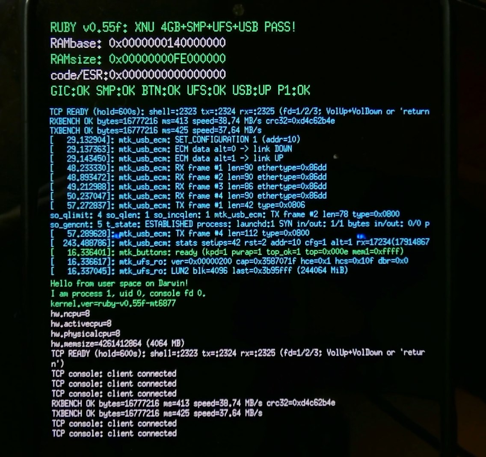
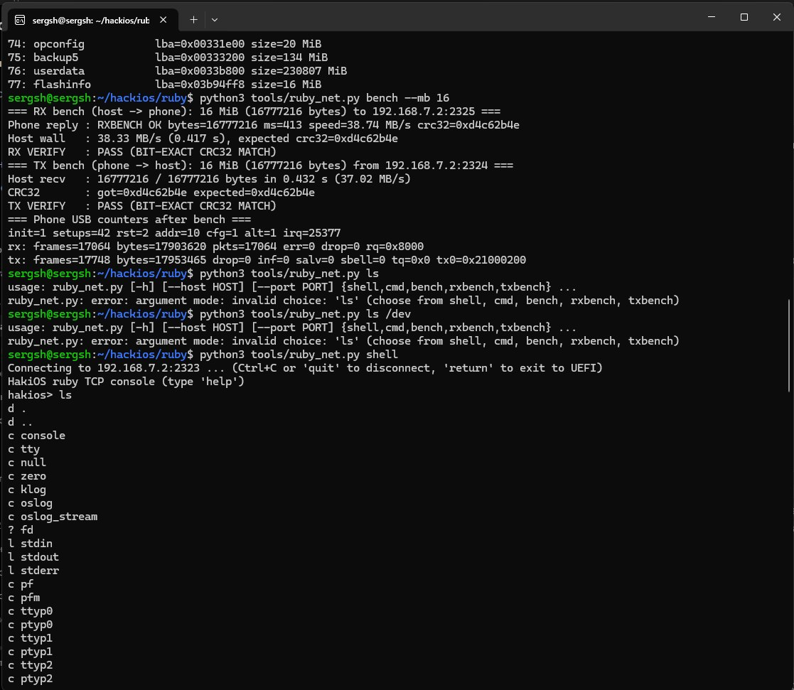
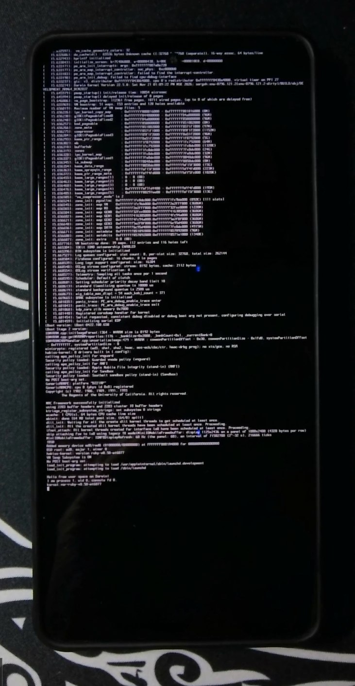
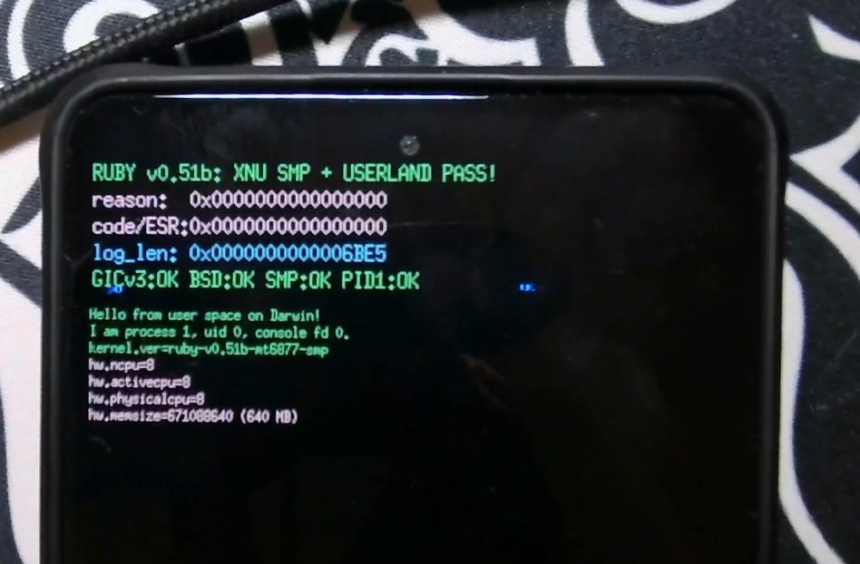

# HakiOS / XNU для Redmi Note 12 Pro 5G (`ruby`)

[-blue)](docs/HARDWARE.md)
[](docs/HARDWARE.md)
[](#архитектура-загрузки)
[](#этапы-ветка-main)
[](#статус-подсистем)

> **Язык:** [English](README.md) | Русский

Нативный запуск **XNU 8796 (Darwin 22.5)** на **Xiaomi Redmi Note 12 Pro 5G (`ruby`, MediaTek MT6877 / Dimensity 1080)** через цепочку **Mu-Silicium UEFI** и собранное из исходников ядро **HakiOS**.

Вся история проекта ведётся в одной линейной ветке `main` — от раннего bring-up на бинарных патчах (`v0.40 → v0.41b`) до текущего ядра XNU из исходников (`v0.50 → v0.55f`), работающего на реальном телефоне с **4064 МиБ ОЗУ выше 4 ГБ (`0x140000000`)**, **8-ядерным PSCI SMP**, **GICv3 + виртуальным таймером**, **консолью на фреймбуфере LK**, **физическими кнопками (`MT6359` + `KPD`)**, **строго read-only сканированием UFS GPT (77 разделов)** и **USB 2.0 High-Speed сетью CDC-ECM (~38 МБ/с в обе стороны, бит-точный CRC32)** с живой TCP-консолью.

---

## Подтверждение на реальном телефоне

Реальные фотографии экрана Redmi Note 12 Pro 5G (`ruby`) и вывод тестов на ПК (без единой записи на UFS):

| `v0.55f` — USB ECM `PASS!` (`38.7 / 37.6 МБ/с`) | `v0.55f` — Тест DMA 16 МиБ + TCP-консоль | `v0.54e` — 4064 МиБ ОЗУ `>4 ГБ` + 8 ядер |
| :---: | :---: | :---: |
|  |  |  |
| `GIC:OK SMP:OK BTN:OK UFS:OK USB:UP P1:OK`, `ESR=0` | `38.74 МБ/с` RX, `37.64 МБ/с` TX, `err=0`, `drop=0` | `RAMbase 0x140000000`, `4064 MB`, `8/8` ядер |

<details>
<summary>Более ранние этапы на телефоне (<code>v0.50</code> и <code>v0.51b</code>)</summary>

| `v0.50` — Первая консоль XNU + PID 1 | `v0.50` — Чистый возврат в UEFI | `v0.51b` — Первый 8-ядерный SMP (`hw.ncpu=8`) |
| :---: | :---: | :---: |
|  |  |  |
| GICv3, IOKit, MiniIOMFB 60 Гц, BSD `md0`, `/sbin/launchd` | `GICv3:OK BSD:OK PID1:OK`, `ESR=0` | `hw.ncpu=8`, `hw.activecpu=8`, `640 MB` ОЗУ |

</details>

---

## Статус подсистем

| Подсистема | Статус | Подробности |
| :--- | :---: | :--- |
| **Mu-Silicium UEFI и Boot v2** | Подтверждено на телефоне | RAM-packed FAT16 (`BOOTAA64.EFI` + `PAYLOAD.XNP`) |
| **Парсер live-FDT и ОЗУ `>4 ГБ`** | Подтверждено на телефоне | Валидация FDT (`0x47C80000`), окно **`4064 МиБ`** `0x140000000..0x23E000000` (резерв `<4 ГБ` `640 МиБ`) |
| **Ядро XNU (`Darwin 22.5`) из исходников** | Подтверждено на телефоне | Включает фиксы `v0.54d`: перекрытие VA `io_map()` на 16-КиБ страницах + `FEAT_CCIDX` для Cortex-A78 |
| **GICv3 и виртуальный таймер (`PPI 27`)** | Подтверждено на телефоне | `GICD 0x0C000000`, `GICR 0x0C040000`, `CNTFRQ = 13 МГц`, USB `IRQ 160` (`SPI 128`) |
| **8-ядерный PSCI SMP** | Подтверждено на телефоне | 6× Cortex-A55 + 2× Cortex-A78 через PSCI SMC (`hw.ncpu=8`, `hw.activecpu=8`) |
| **Экран (`video_console` + IOMFB)** | Подтверждено на телефоне | Фреймбуфер LK `0x7C406000` (`1080×2400`, 60 Гц); опциональный `--apple-splash` |
| **Физические кнопки (`KPD` + `MT6359`)** | Подтверждено на телефоне | `VolDown` (`KPD`), `Power`/`VolUp` (`PMIC MT6359` через read-only `pwrap`), выход `VolUp+VolDown` |
| **UFS (`ufshci@11270000`)** | Подтверждено на телефоне (RO) | Строго read-only опрос `LUN 0..2`; `77` разделов GPT (`userdata` `230 807 МиБ`), **0 записей** |
| **USB MTU3 + 36-бит QMU + CDC-ECM (`en0`)** | Подтверждено на телефоне | `VID 0x1209 / PID 0x0003`, `192.168.7.2/24`, **38.74 МБ/с RX / 37.64 МБ/с TX**, бит-точный CRC32 |
| **TCP-консоль и DMA-бенчмарк (`PID 1`)** | Подтверждено на телефоне | `:2323` консоль (`info/mem/usb/ufs/dmesg/ls/sysctl/touch/return`), `:2324` TX / `:2325` RX CRC32 |
| **Тачскрин (`SPI3` FocalTech `FT3680`)** | Отложено после userland | На первом этапе UI управляется виртуальными нажатиями в `/dev/hakios-touch` по USB |
| **Полный userland iOS 16.5 (`SpringBoard`)** | Следующий шаг (`v0.56 → v0.60`) | Сетевой блочный диск APFS по USB ECM → настоящий `launchd`, SSH, `backboardd`, `SpringBoard` |

---

## Архитектура загрузки

```text
MediaTek LK (boot.img v2)
  └─► Mu-Silicium UEFI (RAM-packed FAT16)
        └─► BOOTAA64.EFI (ebsprobe/v50_loader.c)
              ├─ Разбирает живой FDT от LK по адресу 0x47C80000
              ├─ Выбирает окно ОЗУ 4064 МиБ на 0x140000000 (резерв: 640 МиБ на 0x90000000)
              ├─ Загружает PAYLOAD.XNP (ядро HakiOS XNU 8796 + PID 1 Mach-O)
              ├─ Ставит перехватчик V50XnuReturn и (опционально) логотип Apple
              └─► XNU kernel_bootstrap() → 8-ядерный SMP → IOKit → BSD md0
                    ├─ mtk_buttons (KPD + PMIC MT6359, read-only)
                    ├─ mtk_ufs_ro  (UFSHCI LUN 0..2 GPT, строго read-only)
                    ├─ mtk_usb_ecm (MTU3 + 36-бит QMU DMA → en0 192.168.7.2/24)
                    └─► PID 1 (/sbin/launchd → TCP-консоль :2323 + DMA-бенчмарк :2324/:2325)
                          └─► Чистый возврат ('return' или VolUp+VolDown) → сводка UEFI на экране
```

Ключевые принципы:
- **Ни одной записи на UFS:** все образы работают из ОЗУ, а драйвер `hakios.mtk_ufs_ro.c` физически не содержит SCSI-команд записи — Android и пользовательские данные остаются нетронутыми.
- **Быстрый USB-канал (~38 МБ/с):** даёт живую консоль, `dmesg` и `sysctl` уже сейчас, а в `v0.56` позволит монтировать APFS-образы iOS прямо с SSD ПК без переразметки флешки телефона.
- **Экранная диагностика:** при выходе по TCP-команде `return`, удержании `VolUp+VolDown` или панике ядра загрузчик `v50_loader.efi` перехватывает управление и выводит `ESR`, флаги подсистем (`GIC/SMP/BTN/UFS/USB/P1`) и ключевые строки лога.

---

## Этапы (ветка `main`)

| Тег | Этап | Где проверено | Результат |
| :--- | :--- | :--- | :--- |
| [`v0.40`](docs/history/PHONE_EVIDENCE.md) | Кооперативное переключение контекста XNU | Телефон + QEMU | Подтверждён `Switch_context` на реальном `ruby` |
| `v0.41-wip`..`v0.41b` | Вытесняющая многозадачность по таймеру XNU AST | QEMU | Исправлено перекрытие `.extra`, IRQ `PPI 27` → `Switch_context` |
| `v0.50` | Сборка HakiOS XNU из исходников + PID 1 | **Телефон** + QEMU | Живая консоль XNU, GICv3, IOKit, BSD `md0`, `Hello from user space on Darwin!` |
| `v0.51b` | 8-ядерный PSCI SMP (ОЗУ `<4 ГБ`) | **Телефон** + QEMU | Подтверждены `hw.ncpu=8`, `hw.activecpu=8`, `640 МиБ` на `ruby` |
| `v0.52`..`v0.53d` | Кнопки (`KPD`+`MT6359`), RO-UFS и поиск SError `>4 ГБ` | **Телефон** + QEMU | Работают все 3 кнопки, RO-UFS `LUN 2` (`77` разделов GPT), локализован SError |
| `v0.54`..`v0.54d` | Фикс SError `>4 ГБ` (`io_map()` 16 КиБ + `FEAT_CCIDX`) | **Телефон** + QEMU | Найдена причина `SLVERR` на GICD (`0x0C000000`); чистый старт `2 ГБ` выше 4 ГБ |
| `v0.54e` | Полное окно ОЗУ `4064 МиБ` выше 4 ГБ | **Телефон** + QEMU | Подтверждены `hw.memsize=4261412864` (`0x140000000`), `8/8` ядер, `ESR=0` |
| `v0.55a`..`v0.55d` | USB MTU3 + TPHY v2 + энумерация EP0 | **Телефон** + QEMU | Починены регистры MTU3/TPHY, 32-бит `FIFO0`, отложенный `DATAEND`, чистое `HakiOS USB ECM` |
| `v0.55e` | 36-битный QMU DMA + CDC-ECM `en0` (`ping`) | **Телефон** + QEMU | `USB:UP`, 5/5 ответов `ping` (`0.502 мс` мин, `0%` потерь) через `usbipd-win` → WSL2 |
| **`v0.55f`** | **Живая TCP-консоль + CRC32 USB DMA бенчмарк** | **Телефон** + QEMU | **38.74 МБ/с RX / 37.64 МБ/с TX** (16 МиБ, бит-точный CRC32, `0` потерь), консоль `:2323` |

---

## Быстрый старт (WSL2 Debian)

Крупные базовые образы (`inputs/*.img`) хранятся вне git и проверяются по `BLOBS.sha256`. Подробная инструкция по сборке, QEMU и пробросу USB через `usbipd-win` — в **[docs/BUILD.md](docs/BUILD.md)**.

```sh
cd ~/hackios/ruby
tools/blobs.sh restore
~/hackios/env/run.sh python -B build_v50.py
# Опционально — загрузка с белым логотипом Apple (обычная сборка не меняется):
~/hackios/env/run.sh python -B build_v50.py --apple-splash
```

Готовый образ `boot` сохраняется в `out/v55f/Mu-ruby-v0.55f-hakios-usb-ecm.img` вместе с `manifest.json` (SHA-256 и запас упаковки).

После загрузки на `ruby` и проброса в WSL2 (`usbipd attach --wsl --busid <BUSID>`):

```sh
sudo modprobe cdc_ether
sudo ip addr add 192.168.7.1/24 dev enx02005e77ee01
sudo ip link set enx02005e77ee01 up

python3 tools/ruby_net.py cmd info
python3 tools/ruby_net.py bench --mb 16
python3 tools/ruby_net.py shell
```

> **Важно:** перед любым тестом убедитесь, что у вас есть проверенный бэкап стокового `boot.img`.

---

## План дальше

1. **`v0.56` — Сетевой блочный диск по USB ECM:** монтировать `root.apfs` / `system.apfs` с SSD ПК поверх канала ~38 МБ/с, оставляя UFS телефона на 100% read-only.
2. **`v0.60` — Полный userland iOS 16.5 (`20F66`) на 8 ядрах:** собрать `root.apfs` / `system.apfs` из IPSW и поднять настоящий `/sbin/launchd` → SSH → `backboardd` → `SpringBoard` (управление по USB через `/dev/hakios-touch` / `rwtouch`).
3. **Доводка железа поверх iOS:** починить тачскрин FocalTech `FT3680` на `SPI3` (с живым SSH отладка пойдёт в разы быстрее) и управление подсветкой (`DSI DCS 0x51`).

## Ссылки и благодарности

- [lky005/ruby-ios-bringup](https://github.com/lky005/ruby-ios-bringup) — референс по железу MT6877 / `ruby` (кнопки, UFS, патчи USB MTU3/TPHY/QMU)
- [oosexgang/hakios-xnu-kernel](https://github.com/oosexgang/hakios-xnu-kernel) — ядро HakiOS XNU и платформенные слои
- [oosexgang/hackios-xnu-userland](https://github.com/oosexgang/hackios-xnu-userland) — userland HakiOS
- [oosexgang/hakios-mt6768](https://github.com/oosexgang/hakios-mt6768) — референсный порт для MediaTek
- [oosexgang/hakios-uefi](https://github.com/oosexgang/hakios-uefi) и [UniXNU/UniXNU](https://github.com/UniXNU/UniXNU) — референсы UEFI и загрузки XNU
