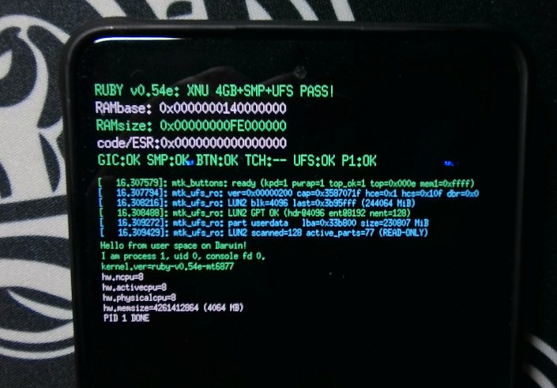
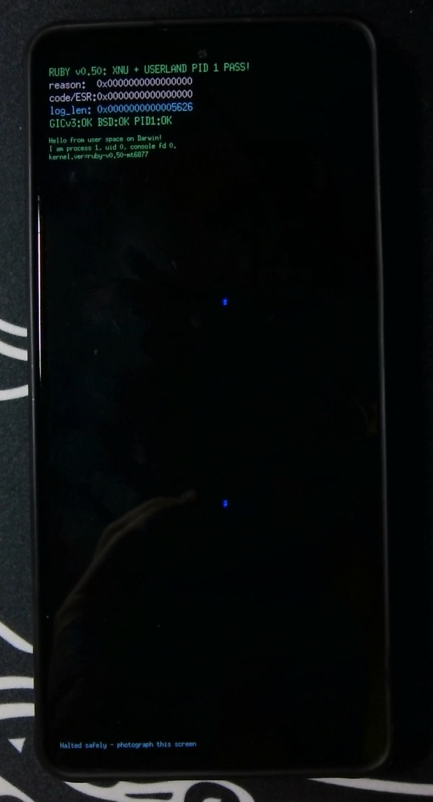

# HakiOS / XNU для Redmi Note 12 Pro 5G (`ruby`)

[-blue)](docs/HARDWARE.md)
[](docs/HARDWARE.md)
[](#архитектура-загрузки)
[](#этапы-ветка-main)
[](#подтверждение-на-реальном-телефоне)

> **Язык:** [English](README.md) | Русский

**УСПЕХ — Полноценная iOS 16.5 (`20F66`, Darwin 22.5) загружается до живого экрана блокировки и рабочего стола SpringBoard с анимациями на реальном Xiaomi Redmi Note 12 Pro 5G (`ruby`, MediaTek MT6877 / Dimensity 1080) по USB NBD с НУЛЁМ записей на UFS-флешку телефона!**

Вся история проекта ведётся в одной линейной ветке `main` — от раннего bring-up на бинарных патчах (`v0.40 → v0.41b`) до текущего ядра **HakiOS / XNU 8796** из исходников (`v0.50 → v0.60b`), загружающего полный **userland iPhone X (`D22AP`) iOS 16.5** поверх нашего стека **USB 2.0 CDC-ECM (~38 МБ/с) + HNBD v1**, с **4064 МиБ ОЗУ выше 4 ГБ (`0x140000000`)**, **8-ядерным PSCI SMP**, **GICv3 + виртуальным таймером**, **MiniIOMobileFramebuffer 60 Гц**, **физическими кнопками (`MT6359` + `KPD`)** (`Power` — пробуждение, удержание `VolDown` → `Home`, `VolUp+VolDown` → чистый возврат в UEFI) и **строго read-only UFS**.

---

## Подтверждение на реальном телефоне — iOS 16.5 SpringBoard на `ruby` (`v0.60b`)

Реальные фотографии **Redmi Note 12 Pro 5G (`ruby`)** с запущенной iOS 16.5 (`20F66`) по USB NBD (ни одной записи на UFS, Android полностью цел):

| `v0.60b` — Живой рабочий стол iOS 16.5 (`SpringBoard`) | `v0.60b` — Живой Lock Screen iOS 16.5 (`CoverSheet`) | `v0.60b` — Автоподхват USB ECM + составной NBD за 1 с |
| :---: | :---: | :---: |
|  |  |  |
| Photos, App Store, Settings, Search, Phone, Safari, Messages — разблокировано физической `VolDown`→`Home` | Настоящие `backboardd` + `SpringBoard` на `ruby`, пробуждение физической кнопкой `Power` | `ruby_usb_auto.ps1` + `ruby_nbd.py --darwin --auto-net` (`unit0` 7.79 ГиБ + `unit1` 4 МиБ) |

<details>
<summary>Более ранние этапы на телефоне (<code>v0.55f</code>, <code>v0.54e</code>, <code>v0.51b</code>, <code>v0.50</code>)</summary>

| `v0.55f` — USB ECM `PASS!` (`38.7 / 37.6 МБ/с`) | `v0.55f` — Тест DMA 16 МиБ + TCP-консоль | `v0.54e` — 4064 МиБ ОЗУ `>4 ГБ` + 8 ядер |
| :---: | :---: | :---: |
|  |  |  |
| `GIC:OK SMP:OK BTN:OK UFS:OK USB:UP P1:OK`, `ESR=0` | `38.74 МБ/с` RX, `37.64 МБ/с` TX, `err=0`, `drop=0` | `RAMbase 0x140000000`, `4064 MB`, `8/8` ядер |

| `v0.50` — Первая консоль XNU + PID 1 | `v0.50` — Чистый возврат в UEFI | `v0.51b` — Первый 8-ядерный SMP (`hw.ncpu=8`) |
| :---: | :---: | :---: |
|  |  |  |
| GICv3, IOKit, MiniIOMFB 60 Гц, BSD `md0`, `/sbin/launchd` | `GICv3:OK BSD:OK PID1:OK`, `ESR=0` | `hw.ncpu=8`, `hw.activecpu=8`, `640 MB` ОЗУ |

</details>

---

## Статус подсистем

| Подсистема | Статус | Подробности |
| :--- | :---: | :--- |
| **Mu-Silicium UEFI и Boot v2** | Подтверждено на телефоне | RAM-packed FAT16 (`BOOTAA64.EFI` + `PAYLOAD.XNP`), режимы `--darwin` и `--apple-splash` |
| **Парсер live-FDT и ОЗУ `>4 ГБ`** | Подтверждено на телефоне | Валидация FDT (`0x47C80000`), окно **`4064 МиБ`** `0x140000000..0x23E000000` (резерв `<4 ГБ` `640 МиБ`) |
| **Ядро XNU (`Darwin 22.5`) из исходников** | Подтверждено на телефоне | Включает фиксы `v0.54d` (`io_map()` 16 КиБ + `FEAT_CCIDX`) и Apple DeviceTree `D22AP` |
| **GICv3 и виртуальный таймер (`PPI 27`)** | Подтверждено на телефоне | `GICD 0x0C000000`, `GICR 0x0C040000`, `CNTFRQ = 13 МГц`, USB `IRQ 160` (`SPI 128`) |
| **8-ядерный PSCI SMP** | Подтверждено на телефоне | 6× Cortex-A55 + 2× Cortex-A78 через PSCI SMC (`hw.ncpu=8`, `hw.activecpu=8`) |
| **Экран (`video_console` + IOMFB)** | Подтверждено на телефоне | Фреймбуфер LK `0x7C406000` (`1080×2400`, 60 Гц); `MiniIOMobileFramebuffer` `1125×2436` BGRA софт-рендер CA |
| **Физические кнопки (`KPD` + `MT6359`)** | Подтверждено на телефоне | `Power` (сон/пробуждение), `VolUp`, `VolDown` (удержание ~0.7 с → `HOME`), `VolUp+VolDown` (1.5 с) → выход в UEFI |
| **UFS (`ufshci@11270000`)** | Подтверждено на телефоне (RO) | Строго read-only опрос `LUN 0..2` (`77` разделов GPT), **0 записей** — Android не затронут |
| **USB MTU3 + 36-бит QMU + CDC-ECM (`en0`)** | Подтверждено на телефоне | `VID 0x1209 / PID 0x0003`, `192.168.7.2/24`, **38.74 МБ/с RX / 37.64 МБ/с TX**, бит-точный CRC32 |
| **Сетевой диск HNBD v1 (`/dev/nbd0..3`)** | Подтверждено на телефоне | Link-aware TCP блочный диск (`192.168.7.1:10809`): составной `rootfs + OS/App Cryptex` (`7.79 ГиБ`) + `root.apfs` |
| **Полный userland iOS 16.5 (`SpringBoard`)** | **Подтверждено на телефоне (`v0.60b`)** | Настоящие `/sbin/launchd`, `dyld_shared_cache_arm64`, `backboardd`, Lock Screen и Home Screen с анимациями |
| **Тачскрин (`SPI3` FocalTech `FT3680`)** | Следующий шаг (`v0.60c`) | В `v0.60b` отключён (`touchscreen=2` ещё не включён в boot-args); доводка аппаратного драйвера — далее |
| **Персистентный `/private/var` (`var.hfs` на `nbd2`) и SSH** | Следующий шаг (`v0.60c`) | Сейчас `tmpfs`; добавим RW `var.hfs` по `nbd2` и `sshd` по USB (`192.168.7.2:22`) |

---

## Архитектура загрузки (`v0.60b` iOS 16.5 через NBD)

```text
MediaTek LK (boot_a, Android boot.img v2 — прошивается только boot_a)
  └─► Mu-Silicium UEFI (RAM-packed FAT16)
        └─► BOOTAA64.EFI (ebsprobe/v50_loader.c + identity.h от D22AP)
              ├─ Разбирает живой FDT от LK (0x47C80000) и выделяет 4064 МиБ ОЗУ на 0x140000000
              ├─ Загружает PAYLOAD.XNP (ядро HakiOS XNU 8796 + 512 КиБ flashboot.apfs md0)
              ├─ Ставит перехватчик V50XnuReturn и (опционально) логотип Apple
              └─► XNU kernel_bootstrap() → 8-ядерный SMP → IOKit → MiniIOMobileFramebuffer
                    ├─ mtk_buttons (KPD + PMIC MT6359: Power, VolUp, VolDown→HOME, VolUp+VolDown→UEFI)
                    ├─ mtk_ufs_ro  (UFSHCI LUN 0..2 GPT, строго read-only)
                    ├─ mtk_usb_ecm (MTU3 + 36-бит QMU DMA → en0 192.168.7.2/24)
                    ├─ nbd0..3     (link-aware клиент HNBD v1 → ПК 192.168.7.1:10809)
                    └─► PID 1 (stage0 в md0)
                          ├─ Спокойно ждёт USB ECM линк и монтирует /dev/nbd1 (root.apfs) → /redwood
                          ├─ exec /redwood/sbin/init → монтирует RO /dev/nbd0 (rootfs.apfs) → /flash
                          ├─ sysctl kern.hakios_switch_root → / + /private/preboot
                          ├─ Монтирует /dev/nbd0,c=1 (OS Cryptex / dyld_shared_cache) и ,c=2 (App Cryptex)
                          └─► exec /sbin/launchd.darwin → backboardd → SpringBoard (Lock Screen и Home Screen)
```

Ключевые принципы:
- **Ни одной записи на UFS:** прошивается только `boot_a` (возврат на Android стоковым `boot.img` занимает секунды). Все образы iOS (`rootfs.apfs`, cryptex-ы, `root.apfs`) лежат на ПК и отдаются по USB через виртуальный составной NBD без склейки 8-гигабайтного файла на диске.
- **Автоподхват на ПК без спешки:** `tools/ruby_usb_auto.ps1` сам перехватывает `VID_1209&PID_0003` за ~1 с и пробрасывает в WSL2 Debian, а `tools/ruby_nbd.py --darwin --auto-net` автоматически поднимает `192.168.7.1/24` и раздаёт все разделы.
- **Экранная диагностика:** при удержании `VolUp+VolDown` или панике ядра `v50_loader.efi` перехватывает управление и выводит `ESR`, статусы подсистем и лог ядра.

---

## Этапы (ветка `main`)

| Тег | Этап | Где проверено | Результат |
| :--- | :--- | :--- | :--- |
| [`v0.40`](docs/history/PHONE_EVIDENCE.md) | Кооперативное переключение контекста XNU | Телефон + QEMU | Подтверждён `Switch_context` на реальном `ruby` |
| `v0.41-wip`..`v0.41b` | Вытесняющая многозадачность по таймеру XNU AST | QEMU | Исправлено перекрытие `.extra`, IRQ `PPI 27` → `Switch_context` |
| `v0.50` | Сборка HakiOS XNU из исходников + PID 1 | **Телефон** + QEMU | Живая консоль XNU, GICv3, IOKit, BSD `md0`, `Hello from user space on Darwin!` |
| `v0.51b` | 8-ядерный PSCI SMP (ОЗУ `<4 ГБ`) | **Телефон** + QEMU | Подтверждены `hw.ncpu=8`, `hw.activecpu=8`, `640 МиБ` на `ruby` |
| `v0.52`..`v0.53d` | Кнопки (`KPD`+`MT6359`), RO-UFS и поиск SError `>4 ГБ` | **Телефон** + QEMU | Работают все 3 кнопки, RO-UFS `LUN 2` (`77` разделов GPT), локализован SError |
| `v0.54`..`v0.54d` | Фикс SError `>4 ГБ` (`io_map()` 16 КиБ + `FEAT_CCIDX`) | **Телефон** + QEMU | Найдена причина `SLVERR` на GICD (`0x0C000000`); чистый старт `2 ГБ` выше 4 ГБ |
| `v0.54e` | Полное окно ОЗУ `4064 МиБ` выше 4 ГБ | **Телефон** + QEMU | Подтверждены `hw.memsize=4261412864` (`0x140000000`), `8/8` ядер, `ESR=0` |
| `v0.55a`..`v0.55d` | USB MTU3 + TPHY v2 + энумерация EP0 | **Телефон** + QEMU | Починены регистры MTU3/TPHY, 32-бит `FIFO0`, отложенный `DATAEND`, чистое `HakiOS USB ECM` |
| `v0.55e` | 36-битный QMU DMA + CDC-ECM `en0` (`ping`) | **Телефон** + QEMU | `USB:UP`, 5/5 ответов `ping` (`0.502 мс` мин, `0%` потерь) через `usbipd-win` → WSL2 |
| `v0.55f` | Живая TCP-консоль + CRC32 USB DMA бенчмарк | **Телефон** + QEMU | **38.74 МБ/с RX / 37.64 МБ/с TX** (16 МиБ, бит-точный CRC32, `0` потерь), консоль `:2323` |
| `v0.56`..`v0.56b` | HNBD v1 (`/dev/nbd0..1`) + APFS/Mach-O exec по TCP | **Телефон** + QEMU | Выровнен 16-байтный SP (`ESR_EC_SP_ALIGN`), смонтирован APFS и выполнен `execve` поверх USB NBD |
| `v0.60a` | Первый полный запуск iOS 16.5 (`20F66`) по NBD до `SpringBoard` | QEMU + Телефон | Составной NBD `rootfs+cryptex-os+cryptex-app`, `identity.h` (`D22AP`), проверен `SpringBoard` в QEMU |
| **`v0.60b`** | **Живой Lock Screen и `SpringBoard` iOS 16.5 на реальном `ruby`** | **Телефон** + QEMU | **Link-aware NBD без спама, автоподхват `usbipd` за 1 с, `VolDown`→`HOME`, живой рабочий стол iOS 16.5 с анимациями на железе!** |

---

## Быстрый старт — запуск iOS 16.5 на `ruby` (WSL2 Debian + Windows)

Крупные базовые образы (`inputs/*.img`) хранятся вне git и проверяются по `BLOBS.sha256`. Проприетарные артефакты IPSW (`rootfs.apfs`, `cryptex-os.dmg`, `cryptex-app.dmg`, `identity.h`) извлекаются локально из `iPhone10,3,iPhone10,6_16.5_20F66_Restore.ipsw` и в git не попадают. Подробная инструкция — в **[docs/BUILD.md](docs/BUILD.md)**.

```sh
cd ~/hackios/ruby
tools/blobs.sh restore
# Сборка образа iOS 16.5 (verbose или чистый splash с логотипом Apple):
~/hackios/env/run.sh python -B build_v50.py --darwin
~/hackios/env/run.sh python -B build_v50.py --darwin --apple-splash
```

Запустите помощники на ПК **до** перезагрузки телефона:

1. **WSL2 Debian** (раздаёт составной `nbd0` + `root.apfs` на `nbd1` и сам настраивает `192.168.7.1/24`):
   ```sh
   python3 ~/hackios/ruby/tools/ruby_nbd.py --darwin --auto-net
   ```
2. **Windows PowerShell** (сам пробрасывает `VID_1209&PID_0003` в WSL2 Debian):
   ```powershell
   powershell -ExecutionPolicy Bypass -File tools\ruby_usb_auto.ps1
   ```
3. **Прошейте только `boot_a` в fastboot и перезагрузите** (кабель не вытыкайте):
   ```powershell
   fastboot flash boot_a Mu-ruby-v0.60b-darwin-splash.img
   fastboot reboot
   ```

Управление на телефоне: **Power** будит экран блокировки, удержание **Volume Down (~0.7 с)** отправляет `HOME` (разблокировка на рабочий стол), а удержание **VolUp + VolDown (1.5 с)** чисто возвращает в UEFI.

> **Важно:** всегда держите под рукой проверенный бэкап стокового `boot.img` (`fastboot flash boot_a boot.img` мгновенно возвращает Android).

---

## План дальше

1. **`v0.60c` — Тачскрин + персистентный `/private/var` + SSH:** запустить `SPI3`-тачскрин (`FocalTech FT3680` / `Goodix GT9916R`), подключить RW `var.hfs` на `/dev/nbd2` для сохранения настроек и быстрых повторных загрузок, и поднять `sshd` по USB (`192.168.7.2:22`).
2. **Плавность UI и доводка железа:** настроить скейлинг / многопоточный блит `MiniIOMobileFramebuffer` (`fbscale`, `fb_threads`), подсветку (`DSI DCS 0x51`) и чтение заряда батареи (`MT6360`).

## Ссылки и благодарности

- [lky005/ruby-ios-bringup](https://github.com/lky005/ruby-ios-bringup) — референс по железу MT6877 / `ruby` (кнопки, UFS, патчи USB MTU3/TPHY/QMU, Goodix GT9916R, подсветка)
- [oosexgang/hakios-xnu-kernel](https://github.com/oosexgang/hakios-xnu-kernel) — ядро HakiOS XNU, userland и платформенные слои
- [oosexgang/xnu-kernel-mtk-helio](https://github.com/oosexgang/xnu-kernel-mtk-helio) — улучшения ядра XNU и IOMFB для MediaTek
- [oosexgang/hackios-xnu-userland](https://github.com/oosexgang/hackios-xnu-userland) — userland HakiOS (архив, перенесён в `hakios-xnu-kernel`)
- [oosexgang/hakios-mt6768](https://github.com/oosexgang/hakios-mt6768) — референсный порт для MediaTek
- [oosexgang/hakios-uefi](https://github.com/oosexgang/hakios-uefi) и [UniXNU/UniXNU](https://github.com/UniXNU/UniXNU) — референсы UEFI и загрузки XNU
